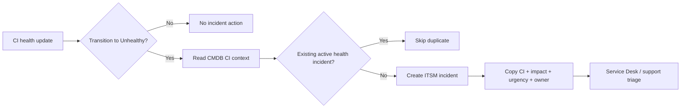

# Architecture and boundaries

## Logical layers

1. **Operational inputs:** Azure and application events (conceptual unless integrated).
2. **CMDB context:** CI identity, health-state field, optional support ownership and relationships.
3. **Automation:** Record-triggered Business Rule OR Flow Designer, duplicate checks, field mapping.
4. **ITSM response:** Incident records, assignment, triage, SLA extensions.
5. **Service visibility:** Dashboards and dependency context (planned extensions).

The code uses CI-level health status but **does not perform Discovery**, ingest Azure events, construct native service maps, or infer actual application impact. The sample statements are hypotheses for technicians to validate.
